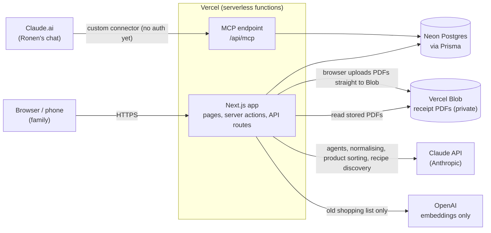
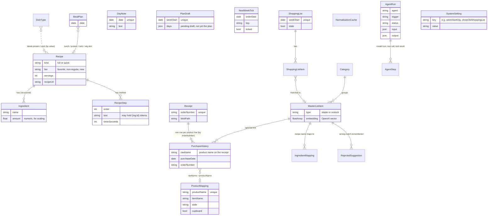
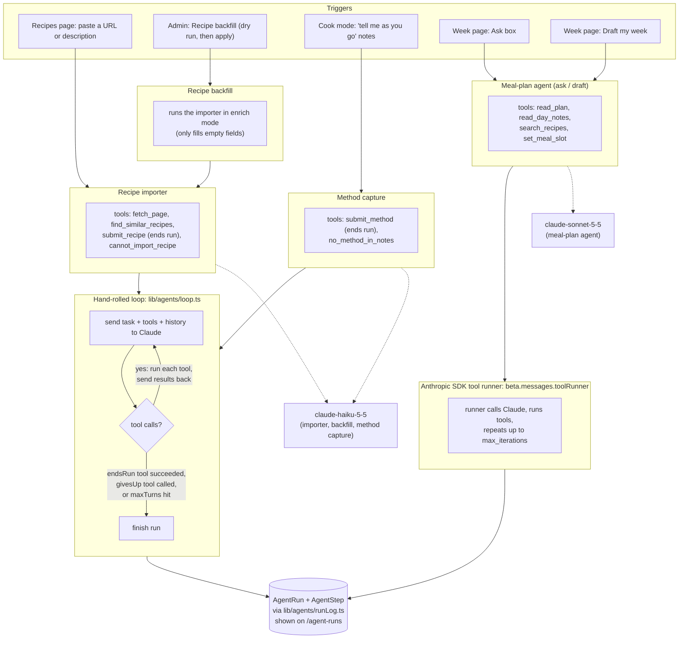
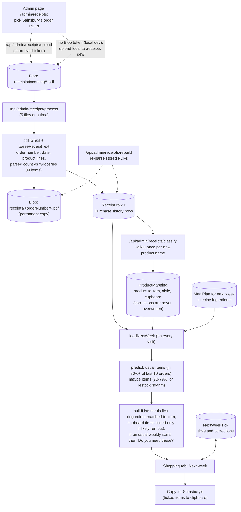
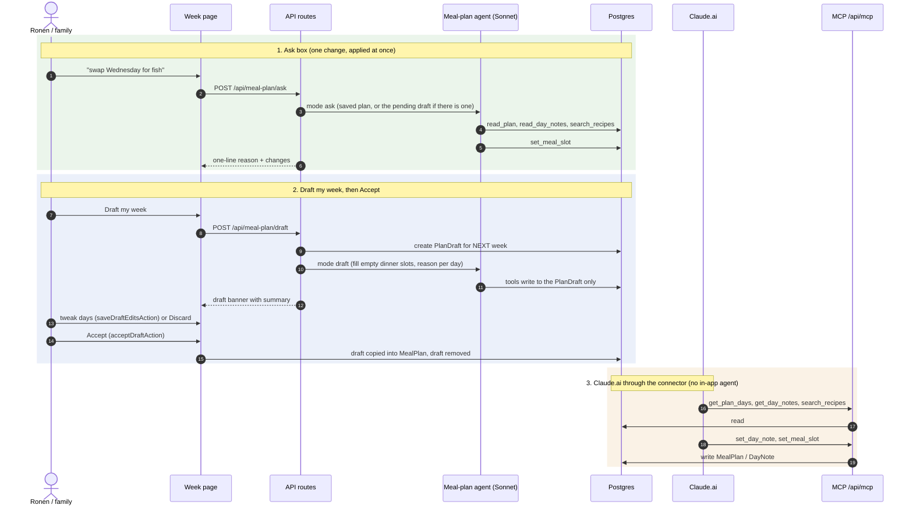
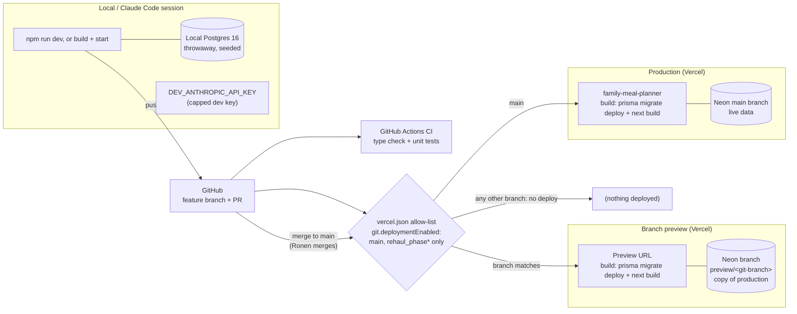

# Architecture

How the Meal Planner is built **as it is today** (after the rehaul, Phases 0–4). Every diagram was drawn by reading the code, not older docs. If a diagram and the code disagree, the code wins: fix the diagram.

GitHub draws the Mermaid diagrams below. For how to run the app, see [README.md](README.md). For the history of how it got here, see [docs/rehaul/](docs/rehaul/).

Contents:
1. [System overview](#1-system-overview)
2. [Data model](#2-data-model)
3. [Agents](#3-agents)
4. [Receipts to Next week](#4-receipts-to-next-week)
5. [Planning flows](#5-planning-flows)
6. [Environments and deploys](#6-environments-and-deploys)
7. [Conventions that matter](#7-conventions-that-matter)

---

## 1. System overview

**What to look at.** Everything the family touches is one Next.js app on Vercel, backed by one Postgres database (Neon). Receipt PDFs are the only files, and they go from the browser straight to private Blob storage. Claude does all generative work from inside the app; Claude.ai reaches the same database through the MCP endpoint, which holds no AI of its own (Claude.ai is the AI there). OpenAI is called only to compute embeddings for the old shopping list. The MCP endpoint has no authentication yet.

---

## 2. Data model

Columns that do not help understanding are left out. Recipes are linked to the meal plan four times (one per slot).

**What to look at.** Five groups:
- **Recipes**: `Recipe` with its `Ingredient` rows (name plus a numeric amount for scaling) and `RecipeStep` rows (method, optional timers). `kind` is `full` or `quick`. A legacy text `ingredients` column on `Recipe` is still read as a fallback.
- **Meal plan and day notes**: one `MealPlan` row per day, pointing at up to four recipes (lunch, protein, carb, veg). `DayNote` is free text per calendar day. `PlanDraft` holds a week the agent drafted until it is accepted (accepting writes `MealPlan` rows).
- **Receipts and purchase history**: `Receipt` is one uploaded order; `PurchaseHistory` has one row per product line, joined to `ProductMapping` by name (product to item, aisle, cupboard flag). `NextWeekTick` remembers ticks on the Next week list. Nothing about the Next week list itself is stored: it is recomputed on each visit.
- **Old shopping list** (still working, hidden by default): `ShoppingList` and items, matched against `MasterListItem` (staples and restock items in `Category` groups, with embeddings), `IngredientMapping`, `RejectedSuggestion` and `NormalisationCache` (table name; the Prisma model is `RecipeIngredientNormalisationCache`).
- **Agent runs**: every agent run is one `AgentRun` with ordered `AgentStep` rows.

The only database link between the receipts data and the old list is the optional `PurchaseHistory.masterItemId`, and nothing in the app reads or writes it any more. `DishType` and `SystemSetting` are small lookups.

---

## 3. Agents

| Agent | Triggered by | Loop | Tools | Model | Run recorded as |
|---|---|---|---|---|---|
| Recipe importer | Recipes page import box (`POST /api/recipes/import`); reviewed draft is saved by `/api/recipes/import/save` | Hand-rolled | `fetch_page`, `find_similar_recipes`, `submit_recipe`, `cannot_import_recipe` | Haiku, 8 turns max | `recipe-importer`, trigger `manual` |
| Recipe backfill | Admin page `/admin/backfill` (plan, then apply after review) | Hand-rolled (uses the importer in enrich mode) | Same as the importer | Haiku | `recipe-importer`, trigger `batch` |
| Method capture | Cook mode (`POST /api/recipes/[id]/capture`); the reviewed method is saved by `/api/recipes/[id]/method` | Hand-rolled | `submit_method`, `no_method_in_notes` | Haiku, 4 turns max | `method-capture`, trigger `manual` |
| Meal-plan agent | Ask box (`/api/meal-plan/ask`), Draft my week (`/api/meal-plan/draft`) | SDK tool runner | `read_plan`, `read_day_notes`, `search_recipes`, `set_meal_slot` | Sonnet, 8 iterations max | `meal-plan`, trigger `manual` |

**What to look at.** The two loops do the same job in different ways. `lib/agents/loop.ts` is written out by hand so it can be read top to bottom: send, run the tools Claude asked for, send the results back, until a tool that "ends the run" succeeds. The meal-plan agent hands that same loop to the SDK's tool runner and only watches the messages to write the run log. Both write through `runLog.ts`, so every model turn, tool call and result can be replayed on `/agent-runs`.

Not agents (single calls, not logged as runs): recipe discovery ("Inspire", Claude with the web search tool, Sonnet), receipt product sorting (Haiku, once per new product name) and old-list ingredient normalising (Haiku). Model names live only in `lib/ai/config.ts`. The `trigger` values `schedule` and `mcp` exist in the type but nothing uses them yet.

---

## 4. Receipts to Next week

**What to look at.** The only stored data is the raw PDFs, the parsed lines, and product-to-item mappings. The Next week list is never saved: `loadNextWeek` recomputes it from purchase history, mappings and next week's meal plan every time, so it cannot go stale. Re-uploading a receipt replaces that order's rows (keyed by order number). The parser reports its own parsed count next to the receipt's printed count, so a mis-parse is visible. "Rebuild" re-parses stored PDFs after a parser change.

---

## 5. Planning flows

**What to look at.** Flow 1 and 2 run the same agent with different instructions and a different store: Ask writes to the saved plan (or to the waiting draft), Draft writes only to `PlanDraft`, and nothing counts as the plan until Accept. Flow 3 has no agent code in the app: Claude.ai is the agent, and the MCP server just exposes tools over the same database (plus recipe tools: `get_recipes`, `get_recipe`, `create_recipe`, `update_recipe`, `get_meal_plan`, `get_shopping_history`). MCP writes are not recorded as agent runs.

---

## 6. Environments and deploys

**What to look at.** Merging to `main` **is** a production deploy. Work happens on a branch, gets a preview with its own copy of the data (a Neon branch made when the preview builds and deleted with the git branch), and Ronen checks it on a phone before merging. The allow-list in `vercel.json` stops Vercel from building any branch that is not `main` or named `rehaul_phase*`; to preview a branch with another name, add its pattern there. CI (GitHub Actions) runs on every PR but has no database: it runs the type check and unit tests only. Integration tests (`npm run test:integration`) run locally against Postgres. `DATABASE_URL` is the pooled connection used at runtime; `DATABASE_URL_UNPOOLED` is the direct one Prisma migrations use.

Database rules: changes only **add** (new tables, nullable columns, columns with defaults) so rolling the code back is safe; renames and drops go in a later PR. Take a Neon backup branch before merging a schema PR. If production breaks: Vercel, Deployments, previous deployment, Instant Rollback, then fix forward.

---

## 7. Conventions that matter

- **Serverless first.** Nothing loads a file by path at runtime. Long routes set `maxDuration`. Work is done in small batches the browser repeats (receipt processing 5 files per call, product sorting in batches).
- **Models are configured in one place**: `lib/ai/config.ts`. Prompts live next to their agent. Prompt caching helpers are in `lib/ai/cache.ts`.
- **Every agent records its runs** through `lib/agents/runLog.ts`; read them on `/agent-runs`.
- **Switches for big new screens** are `SystemSetting` rows (for example `showOldShoppingList`, off by default).
- **Code layout:** `app/` (pages, server actions, API routes), `components/` (shared UI), `lib/` (logic by area: `agents`, `ai`, `mealPlanAgent`, `nextWeek`, `receipts`, `mcp`, `cook`, `shopping-list`), `prisma/` (schema, migrations, seed), `tests/` (integration tests), `scripts/` (one-off and developer tools), `docs/`.
